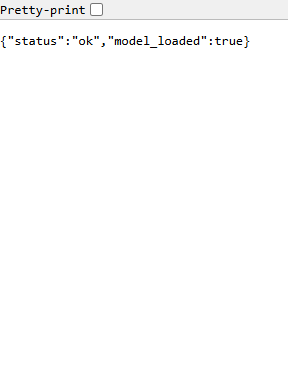
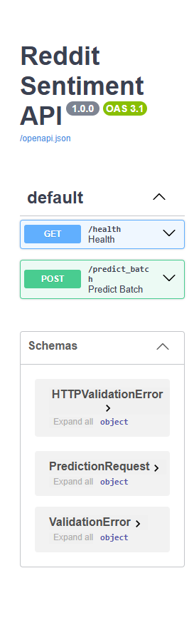
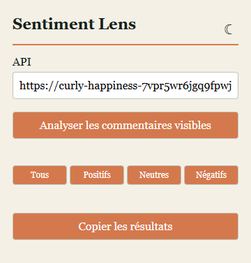
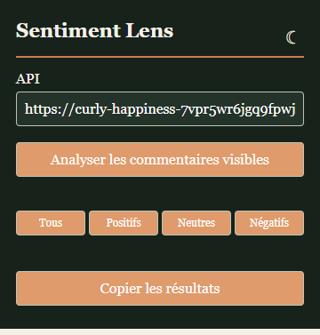

# YouTube Sentiment Lens

**Réalisé par : Ilyas Fardaoui — Encadré par : Prof. Maria Zemzami** · Filière INDIA, ENSAM Rabat (2026/27)

Projet MLOps de classification de sentiment des commentaires Reddit/YouTube avec TF-IDF, Logistic Regression optimisée, API FastAPI et extension Chrome Manifest V3.

## Architecture

`data/raw` conserve la source; `data/processed` contient les splits et l'EDA; `src/data` prépare les données; `src/models` entraîne et évalue; `src/api` sert le pipeline; `chrome-extension` fournit l'interface; `Dockerfile` conteneurise l'API sur le port 7860 pour GitHub Codespaces.

```
YouTube (page vidéo)
   │  content.js extrait les commentaires visibles
   ▼
Extension Chrome (popup.js)  ──POST /predict_batch──►  API FastAPI (src/api)
   ▲                                                      │  pipeline TF-IDF + Logistic Regression
   └──────────── prédictions + statistiques ◄────────────┘
```

La documentation détaillée des endpoints est dans [docs/API.md](docs/API.md); le rapport technique complet est dans [rapport_technique.pdf](rapport_technique.pdf).

## Installation et exécution

```powershell
py -3 -m venv .venv
.\.venv\Scripts\Activate.ps1
python -m pip install -r requirements.txt
python -m src.models.train
uvicorn app_api:app --reload --port 8000
```

Le téléchargement est automatique et écrit `data/raw/reddit.csv`. Le modèle et les métriques sont écrits dans `models/`. Pour l'extension : ouvrir `chrome://extensions`, activer le mode développeur, puis charger le dossier `chrome-extension`.

## Validation

```powershell
pytest -q
```

Les métriques complètes sont dans `models/metrics.json`; le seuil demandé est accuracy >= 0.80, F1 par classe > 0.75 et inférence d'un batch de 50 < 100 ms.

## Déploiement cloud gratuit avec GitHub Codespaces

Le TP utilise GitHub Codespaces, car les Docker Spaces Hugging Face nécessitent désormais un abonnement payant. Depuis GitHub : **Code > Codespaces > Create codespace on main**. Dans le terminal du Codespace, exécuter :

```bash
docker build -t youtube-sentiment-api .
docker run -d -p 7860:7860 -e PORT=7860 youtube-sentiment-api
```

Dans l'onglet **Ports**, rendre le port `7860` public. L'URL `https://<nom-du-codespace>-7860.app.github.dev` doit répondre sur `/health`, `/docs` et `/predict_batch`. Remplacer ensuite l'URL de l'API dans `chrome-extension/popup.html` par cette URL et recharger l'extension. Le Codespace est éphémère : il doit rester allumé et être relancé avant la démonstration.

## Démonstration

Installation de l'extension : ouvrir `chrome://extensions`, activer le **Mode développeur**, cliquer **Charger l'extension non empaquetée** et sélectionner le dossier `chrome-extension` (ou décompresser `chrome-extension.zip`). Ouvrir une vidéo YouTube, cliquer sur l'icône, puis **Analyser les commentaires visibles**.

| API `/health` | API `/docs` (Swagger) |
|---|---|
|  |  |

| Extension — mode clair | Extension — mode sombre |
|---|---|
|  |  |

## Questions de réflexion

- Séparer raw/processed protège la source originale et rend les transformations reproductibles.
- Les secrets, environnements virtuels, caches, logs, données générées et modèles lourds ne doivent pas être commités.
- TF-IDF réduit le poids des mots fréquents et valorise les termes discriminants; la matrice de confusion montre les confusions entre classes.
- Les emojis sont conservés autant que possible par le nettoyage Unicode; les URLs et mentions sont remplacées par des tokens pour garder leur signal sans leur bruit.
- Un split stratifié 80/20 conserve la distribution des classes.
- FastAPI apporte validation Pydantic, documentation OpenAPI et bonnes performances; CORS autorise l'extension à appeler l'API.
- Les commentaires YouTube sont dynamiques : le content script lit ceux présents, et l'utilisateur peut relancer l'analyse après chargement de nouveaux commentaires.
- Les requirements dev incluent tests/EDA; la production ne conserve que les dépendances d'exécution, ce qui réduit l'image Docker.
